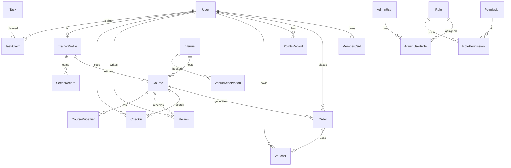
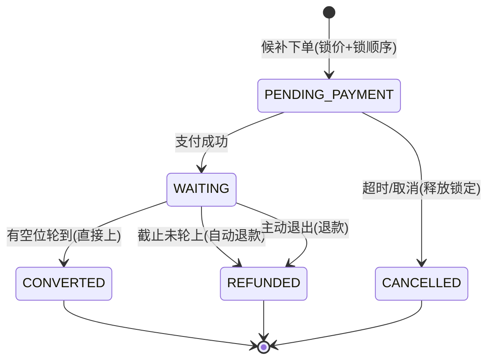

# Full愈 · 数据模型与后端 Spec / PRD

> 本文档是 Full愈 教育培训 SaaS 系统的**数据契约与后端控制逻辑说明书**。
> 目的：冻结数据模型与业务规则，使前端 UI 可自由微调而后端不返工；同时可作为交付给其他开发者/AI 的技术依据。
>
> 权威来源：`apps/server/prisma/schema.prisma`（数据库定义）、`packages/shared/src/*`（前后端共享类型与常量）、`apps/server/src/modules/*`（已实现的后端逻辑）。
>
> ⚠️ 文末【第 15 节 · 待确认与冲突清单】列出了「后台前端 mock」与「后端契约」之间不一致的字段，落库前须先统一。

---

## 1. 技术栈与部署架构

| 层 | 技术 |
|---|---|
| 小程序端 | uni-app + Vue 3 + TypeScript + Pinia（首页 / 课程 / 会员 / 我的 四 Tab） |
| PC 后台 | Vue 3 + Vite + Ant Design Vue 4 + vue-router + Pinia + axios |
| 后端 | NestJS + Prisma ORM + PostgreSQL + Redis(ioredis) + JWT + Swagger |
| 支付 | 微信支付 V3 API |
| 消息 | 微信公众平台模板消息 / 小程序订阅消息 |
| 文件存储 | 腾讯云 COS / 阿里云 OSS |
| 工程结构 | pnpm workspaces monorepo：`apps/miniprogram` + `apps/admin` + `apps/server` + `packages/shared` + `packages/design-tokens` |

---

## 2. 全局约定

### 2.1 主键与字段命名
- **主键**：所有表统一使用 `String @id @default(cuid())`（cuid 字符串，非自增整型）。
- **DB 列名**：数据库列使用 `snake_case`（通过 Prisma `@map` 映射），Prisma 模型字段使用 `camelCase`。
- **时间戳**：绝大多数表含 `createdAt`(`@default(now())`) 与 `updatedAt`(`@updatedAt`)。
- **金额**：一律使用 `Decimal` 类型（避免浮点误差），单位为**元**。
- **枚举**：使用 Prisma `enum` 定义，前后端通过 `packages/shared` 的 TS enum 对齐。

### 2.2 统一响应体
```ts
interface IApiResponse<T> { code: number; message: string; data: T }
interface IPaginatedResponse<T> { items: T[]; total: number; page: number; pageSize: number; totalPages: number }
```
- 分页请求统一 `{ page, pageSize }`，默认 `page=1, pageSize=10`。

### 2.3 鉴权
- **小程序端**：`AuthGuard('jwt')`，JWT payload = `{ sub: userId, phone, isTrainer }`。
- **后台端**：独立密钥 `ADMIN_JWT_SECRET`，默认有效期 `24h`，payload = `{ sub: adminId, username, type:'admin' }`。
- 后台接口须结合 RBAC 权限码（见第 13 节）做细粒度校验。

### 2.4 语言
- 用户级字段 `language`：`'zh' | 'en'`，默认 `zh`。课程标签等基础数据带中英双字段。

---

## 3. 数据模型总览（实体关系）



**实体清单（共 20+ 模型）**：User、TrainerProfile、MemberCard、PointsRecord、SeedsRecord、Course、CoursePriceTier、CourseTag、Venue、VenueReservation、Order、CheckIn、Review、Voucher、Task、TaskClaim、Material、AdminUser、Role、Permission、AdminUserRole、RolePermission、Settlement。

---

## 4. 用户模块（User）

### 4.1 表结构 `users`
| 字段 | 类型 | 说明 |
|---|---|---|
| id | String(cuid) | 主键 |
| phone | String **@unique** | 手机号，登录唯一标识 |
| nickname | String | 昵称，微信登录默认 `用户{手机后4位}` |
| avatar | String? | 头像 URL |
| openId | String? @unique | 微信小程序 openId |
| unionId | String? | 微信开放平台 unionId |
| language | String default("zh") | 语言偏好 zh/en |
| isTrainer | Boolean default(false) | 是否为培训师（关联 TrainerProfile） |
| createdAt / updatedAt | DateTime | 时间戳 |

**关系**：一个 User 拥有多张会员卡、多个订单、积分记录、代金券、评价、签到；可选地对应一个 TrainerProfile；可领取多个任务。

### 4.2 字段用法
- `phone` 是业务唯一键，微信一键登录通过 code 换取手机号后 `upsert`。
- `isTrainer` 为身份开关；培训师的专业资料存于 `TrainerProfile`，与 User 一对一。
- 前端「用户身份」概念（普通/会员/培训师）是**派生态**，不落库为字段：
  - 会员 = 存在 `status != EXPIRED` 的 MemberCard；
  - 培训师 = `isTrainer=true`。

### 4.3 后端控制逻辑
- **微信手机号登录** `POST /auth/wechat/phone-login`：
  1. 用 `code` 调微信 API 换手机号（`getPhoneFromWechat`，待接入真实 API）；
  2. `findUnique({phone})`，不存在则创建；
  3. 签发 JWT 返回 `{ token, user }`。
- **获取个人信息** `GET /user/profile`：返回用户 + 未过期会员卡 + 培训师资料。
- **更新资料** `PUT /user/profile`：仅允许改 `nickname / avatar / language`。
- 小程序会员购买时需补充「称呼 / 性别 / 生日」：User 增 `gender`（MALE/FEMALE/OTHER）与 `birthday`(DateTime?) 字段（决策 ✅），`nickname` 复用为称呼。

---

## 5. 培训师模块（TrainerProfile / SeedsRecord / Settlement）

### 5.1 表结构 `trainer_profiles`
| 字段 | 类型 | 说明 |
|---|---|---|
| id | String(cuid) | 主键 |
| userId | String @unique | 关联 User（一对一） |
| displayName | String | 对外展示名 |
| avatar | String? | 头像 |
| level | Int default(1) | 等级 LV1–LV5 |
| certBadge | String? | 认证等级徽章 |
| specialties | String[] | 擅长领域标签 |
| bio | String? | 个人简介 |
| hourlyRate | Decimal default(0) | 课时单价（结算用） |
| seedsBalance | Int default(0) | Seeds 余额 |
| createdAt / updatedAt | DateTime | 时间戳 |

### 5.2 字段用法与等级时薪
- `level` 对应默认时薪（后台可配置，建议做成值集 `trainer_level`）：

| 等级 | 名称 | 默认时薪 |
|---|---|---|
| LV1 | 初级 | ¥200 |
| LV2 | 中级 | ¥300 |
| LV3 | 高级 | ¥450 |
| LV4 | 资深 | ¥600 |
| LV5 | 首席 | ¥800 |

- `hourlyRate` 落到导师个体，优先于等级默认值用于结算。
- 导师状态（在职 ACTIVE / 休假 LEAVE / 离职 RESIGNED）：TrainerProfile 增 `status` 字段（决策 ✅），默认 ACTIVE。

### 5.3 Seeds 系统 `seeds_records`（培训师积分，与用户积分独立）
| 字段 | 类型 | 说明 |
|---|---|---|
| id | String(cuid) | 主键 |
| trainerId | String | 关联 TrainerProfile |
| amount | Int | 正=增加 / 负=减少 |
| balance | Int | 变动后余额 |
| type | String | COURSE_SETTLEMENT / TASK_REWARD / ADMIN_ADJUST |
| reason | String | 变动原因 |
| relatedId | String? | 关联课程/任务 ID |
| createdAt | DateTime | 时间戳 |

- Seeds 通过「完成课程结算」「完成任务」「管理员调整」变动，采用**流水+快照余额**模式（每条记录带变动后 `balance`）。

### 5.4 结算 `settlements`
| 字段 | 类型 | 说明 |
|---|---|---|
| id / trainerId / courseId | String | 主键与关联 |
| hours | Decimal | 课程时长 |
| rate | Decimal | 结算单价 |
| amount | Decimal | 结算金额 = hours × rate |
| settledAt | DateTime | 结算时间 |

### 5.5 后端控制逻辑
- **课程结算**：课程 `COMPLETED` 后，按 `hours × hourlyRate` 生成 Settlement，并按课程 `trainerSeeds` 给导师发放 Seeds（写 SeedsRecord）。
- Seeds 可用于兑换物料（Material.seedsCost）。

---

## 6. 会员卡模块（MemberCard）

### 6.1 表结构 `member_cards`
| 字段 | 类型 | 说明 |
|---|---|---|
| id | String(cuid) | 主键 |
| userId | String | 持卡用户 |
| type | MemberCardType | MONTHLY / QUARTERLY / YEARLY |
| status | MemberCardStatus | ACTIVE / FROZEN / EXPIRED，默认 ACTIVE |
| startDate | DateTime | 生效日 |
| endDate | DateTime | 到期日 |
| absences | Int default(0) | 当月未出席次数 |
| createdAt / updatedAt | DateTime | 时间戳 |

### 6.2 字段用法
- `type`：月卡 / 季卡 / 年卡，决定有效期与会员折扣力度。
- `absences`：连续/当月缺席计数，用于自动冻结判断。
- **会员卡价格配置化**（决策 ✅）：价格不再硬编码，由后台「会员卡商品发布」维护（见 6.3 `MemberCardProduct`）。购买时将当时价格快照到订单，后续价格调整不影响历史卡。

### 6.3 会员卡商品 `member_card_products`（新增 · 决策 ✅）
后台可发布 / 编辑 / 上下架会员卡商品，小程序会员中心动态读取展示，前后端价格统一。

| 字段 | 类型 | 说明 |
|---|---|---|
| id | String(cuid) | 主键（会员卡商品唯一 id） |
| type | MemberCardType | MONTHLY / QUARTERLY / YEARLY |
| name | String | 商品名（如「季卡」） |
| price | Decimal | 售价（可随时修改，不影响已购卡） |
| originalPrice | Decimal? | 划线原价（营销用） |
| durationDays | Int | 有效时长（天），或按 type 推导 |
| benefits | String[] | 权益描述列表 |
| description | String? | 商品说明 |
| coverImage | String? | 商品图 |
| isActive | Boolean default(true) | 是否上架 |
| sort | Int default(0) | 排序 |
| createdAt / updatedAt | DateTime | 时间戳 |

- **购买流程**：选商品 → 生成会员卡订单（`orderType=MEMBERCARD`，见第 10 节）→ 支付成功 → 创建 `MemberCard`（唯一 id）并回填有效期。
- 小程序会员中心「月卡/季卡/年卡」的价格与权益全部来自本表，彻底消除历史 ¥299/¥799/¥2599 与 ¥699/¥1980/¥5980 的冲突（以后台配置为准）。

### 6.4 后端控制逻辑
- **有效期计算**：购买/续费成功后按 type 累加时长（月+1月 / 季+3月 / 年+1年），已有有效卡则顺延 `endDate`。
- **自动冻结**：`absences >= MEMBER_FREEZE_THRESHOLD(=3)` 时 `status → FROZEN`。
- **自动过期**：定时任务扫描 `endDate < now` 的 ACTIVE 卡 → `EXPIRED`。
- **到期提醒**：`MEMBER_EXPIRY_REMIND_DAYS = [7,3,1]` 天前推送模板消息。
- **会员折扣**：作用于课程报名价（见第 8 节 & 第 14.2 定价引擎）。

---

## 7. 用户积分模块（PointsRecord）

### 7.1 表结构 `points_records`
| 字段 | 类型 | 说明 |
|---|---|---|
| id | String(cuid) | 主键 |
| userId | String | 用户 |
| amount | Int | 正=增加 / 负=减少 |
| balance | Int | 变动后余额（快照） |
| type | PointsChangeType | 见下 |
| reason | String | 变动原因描述 |
| relatedId | String? | 关联订单/课程 ID |
| createdAt | DateTime | 时间戳 |

**PointsChangeType**：`COURSE_REWARD`(上课奖励) / `REVIEW_REWARD`(评价奖励) / `CONSUMPTION`(消费抵扣) / `EXCHANGE`(积分兑换) / `ADMIN_ADJUST`(管理员调整) / `OTHER`。

### 7.2 字段用法与逻辑
- **流水+快照**模式：余额不单独存表，通过最新一条记录的 `balance` 读取（`getPointsBalance` 取 `createdAt desc` 第一条）。
- **抵扣比例**：`POINTS_TO_YUAN_RATIO = 1`（1 积分 = 1 元）。
- **发放时机**：完成课程发 `COURSE_REWARD`（课程 `seedsReward`/积分奖励配置），提交评价发 `REVIEW_REWARD`（`reviewSeeds`）。
- **调整**：后台可手动增减（`ADMIN_ADJUST`），须记录 reason。
- 接口：`GET /user/points`（余额）、`GET /user/points/history`（明细分页）。

---

## 8. 课程模块（Course / CoursePriceTier / CourseTag）

### 8.1 表结构 `courses`
| 字段 | 类型 | 说明 |
|---|---|---|
| id | String(cuid) | 主键 |
| title | String | 标题（≤ `COURSE_TITLE_MAX_LENGTH=30`） |
| coverImage | String | 封面图 |
| type | CourseType | SINGLE(单次) / SERIES(系列)；**已删除** GROUP/PRIVATE/WORKSHOP/EXPERIENCE 授课形式分类（决策 ✅，小程序+后台同步移除） |
| categories | String[] | 分类标签（正念/音声/戏剧/舞动/精油/其他） |
| description | String | 富文本详情（≤ `COURSE_DESC_MAX_LENGTH=500`） |
| targetAudience | String[] | 适合人群 |
| learningGoals | String? | 学习目标 |
| startDate / endDate | DateTime | 起止日期 |
| startTime / endTime | String | HH:mm |
| trainerId | String | 授课导师 |
| minCapacity / maxCapacity | Int | 最小成团 / 最大容量 |
| currentEnrolled | Int default(0) | 当前已报名数 |
| originalPrice | Decimal | 原价 |
| venueId | String | 场地 |
| status | CourseStatus | DRAFT / PUBLISHED / CANCELLED / COMPLETED / EXPIRED |
| trainerSeeds | Int default(0) | 导师完成可得 Seeds |
| allowDeduction | Boolean default(true) | 是否支持积分抵扣 |
| internalNote | String? | 内部备注 |
| enrollStartAt / enrollEndAt | DateTime? | 报名起止 |
| memberEnrollStartAt | DateTime? | 会员提前报名时间 |
| refundRules | Json | 课程级退款规则（决策 ✅，见 10.4），`[{hoursBefore,percent}]` |
| gallery | String[] | 详情页图集（决策 ✅） |
| scheduleType | ScheduleType | RECURRING/SINGLE/APPOINTMENT 排期方式（决策 ✅） |
| weekdays | String[] | 周期排期的星期（scheduleType=RECURRING 时） |
| waitlistEnabled | Boolean default(false) | 是否开启候补（决策 ✅，见第 18 节） |
| waitlistDeadlineHours | Int? | 候补截止：开课前 N 小时，取值 48/24/6/1/0.5 |
| memberWaitlistSeats | Int default(3) | 会员候补席位数（决策 ✅，满后会员也进普通队列） |
| createdAt / updatedAt | DateTime | 时间戳 |

### 8.2 阶梯价格 `course_price_tiers`（按报名顺序区间 · 决策 ✅）
课程发布时按「报名人员顺序区间」统一配置基础价，与会员卡类型解耦（会员折扣单独在 8.5 维护）。

| 字段 | 类型 | 说明 |
|---|---|---|
| id | String(cuid) | 主键 |
| courseId | String | 课程 |
| seatFrom | Int | 区间起始顺位（含，1-based） |
| seatTo | Int | 区间结束顺位（含） |
| price | Decimal | 该区间基础价 |
| — | @@unique([courseId, seatFrom]) | 同课程区间不重叠 |

- 语义示例：第 1-2 位 ¥300、第 3-4 位 ¥330、第 5-8 位 ¥360。
- **询价与锁价（决策 ✅）**：每次下单询价时，后端按「当前 `currentEnrolled+1` 落在哪个区间」查**最新**区间价格，并在锁席位时**锁定该价格**写入订单，避免支付期间区间变动导致价格漂移。
- 基础价确定后，再按 8.5 会员折扣叠加计算最终应付价。

### 8.3 课程标签 `course_tags`
| 字段 | 类型 | 说明 |
|---|---|---|
| id / nameZh / nameEn / sort | — | 中英双语标签 + 排序 |

默认分类常量 `DEFAULT_COURSE_CATEGORIES`：MINDFULNESS/SOUND/DRAMA/DANCE/ESSENTIAL_OIL/OTHER。

### 8.4 后端控制逻辑
- **列表查询** `GET /courses`（小程序）：仅返回 `PUBLISHED`；支持时间筛选（today/week/month）、分类筛选（`categories has`）、价格排序（asc/desc）、分页。
- **详情** `GET /courses/:id`：含 trainer、venue、priceTiers。
- **状态流转**：DRAFT →（发布）→ PUBLISHED →（开课完成）→ COMPLETED；可 CANCELLED；过期 → EXPIRED。
- **报名窗口**：`enrollStartAt/enrollEndAt` 控制普通报名；`memberEnrollStartAt` 允许会员提前报名。
- **成团逻辑**：`currentEnrolled` 达到 `minCapacity` 成团；未达成团线且截止 → 触发退款/取消。
- **后台创建**采用 5 步流程：基本信息 → 排期与场地 → 定价与名额 → 大纲与退款规则 → 确认发布。

### 8.5 课程会员折扣 `course_member_discounts`（新增 · 决策 ✅）
会员折扣在**课程发布时维护**，不同课程可对不同会员卡设置不同折扣。

| 字段 | 类型 | 说明 |
|---|---|---|
| id | String(cuid) | 主键 |
| courseId | String | 课程 |
| cardType | MemberCardType | MONTHLY / QUARTERLY / YEARLY |
| discountPercent | Int | 折扣百分比（如 70 = 打 7 折） |
| — | @@unique([courseId, cardType]) | 每课每卡类型一条 |

- 计算：`应付价 = 阶梯基础价 × discountPercent / 100`；无配置则不打折（100%）。
- 未持卡用户按基础价；持卡用户按其卡类型对应折扣。


---

## 9. 场地模块（Venue / VenueReservation）

### 9.1 表结构 `venues`
| 字段 | 类型 | 说明 |
|---|---|---|
| id | String(cuid) | 主键 |
| name | String | 场地名 |
| address | String | 地址 |
| images | String[] | 场地图片 |
| businessHours | String | 营业时间（JSON 字符串） |
| isAvailable | Boolean default(true) | 是否可用 |
| createdAt / updatedAt | DateTime | 时间戳 |

### 9.2 场地预约 `venue_reservations`
| 字段 | 类型 | 说明 |
|---|---|---|
| id / venueId | String | 主键与关联 |
| date | DateTime | 预约日期 |
| startTime / endTime | String | HH:mm |
| eventName | String | 活动名称 |
| contactName / contactPhone | String | 联系人 |
| internalContact | String? | 内部对接人 |
| note | String? | 备注 |
| createdAt | DateTime | 时间戳 |

### 9.3 后端控制逻辑
- **冲突校验**：同一 `venueId` + `date` 下时间段不可重叠（课程排期 + 预约共同占用），创建前须校验。
- **日历视图**：后台以日历聚合展示课程占用与外部预约。
- **签到关联**：场地可作为课程签到的地理/扫码锚点。

---

## 10. 订单与支付模块（Order）

### 10.1 表结构 `orders`
| 字段 | 类型 | 说明 |
|---|---|---|
| id | String(cuid) | 主键 |
| userId | String | 下单用户 |
| courseId | String | 关联课程 |
| originalPrice | Decimal | 原价 |
| discountAmount | Decimal default(0) | 会员/活动折扣额 |
| pointsDeduction | Decimal default(0) | 积分抵扣额 |
| voucherDeduction | Decimal default(0) | 代金券抵扣额 |
| actualPaid | Decimal | 实付 = 原价 − 各项抵扣（下限 0） |
| status | OrderStatus | 见下 |
| paymentId | String? | 微信支付单号 |
| paymentTime | DateTime? | 支付时间 |
| cancelTime / cancelReason | — | 取消时间与原因 |
| refundAmount / refundTime | — | 退款金额与时间 |
| voucherId | String? | 使用的代金券 |
| orderType | OrderType | COURSE / MEMBERCARD 订单类型（决策 ✅） |
| memberCardProductId | String? | 会员卡商品 id（购买的是哪款卡） |
| memberCardId | String? | 支付成功后生成的会员卡唯一 id |
| cardType | MemberCardType? | 会员级别（月/季/年，冗余快照便于查询） |
| createdAt / updatedAt | DateTime | 时间戳 |

> 注：`courseId` 由必填改为**可空**（MEMBERCARD 订单无课程）。

**OrderStatus**：`PENDING_PAYMENT`(待支付) / `PAID`(已支付待开课) / `COMPLETED`(已完成) / `CANCELLED`(已取消) / `REFUNDING`(退款中) / `REFUNDED`(已退款)。
**OrderType（决策 ✅）**：`COURSE`(课程订单，关联 courseId) / `MEMBERCARD`(会员卡订单，关联 memberCardProductId)。

> **会员卡购买链路（决策 ✅）**：下单(`MEMBERCARD` + memberCardProductId) → 支付成功 → 创建 `MemberCard`（唯一 id）→ 回填 `memberCardId`/`cardType` 到订单，实现「此订单用哪张卡、什么级别」全程可追溯。

### 10.2 席位锁定（Redis 分布式锁）
- `POST /orders/lock-seat`：
  1. 校验课程存在且 `currentEnrolled < maxCapacity`；
  2. Redis `SET seat_lock:{courseId}:{userId} 1 EX {ttl} NX`，`SEAT_LOCK_DURATION_MINUTES = 10` 分钟；
  3. 锁定成功返回 `{ locked:true, ttl }`，否则提示「10 分钟内完成支付」。
- 释放：取消订单或超时自动释放（TTL 到期）。
- **统一下单锁定原语（决策 ✅）**：普通报名、候补报名、会员卡购买均遵循同一链路——**锁定（价格+席位/顺序）→ 生成限时待支付订单 → 支付成功=占位成功 / 支付失败（超时或取消）=释放锁定**；重新报名/候补时按**最新价格与最新轮次**重新锁定。详见第 18 节。

### 10.3 价格计算（下单）
`POST /orders`：
```
actualPaid = max(0, originalPrice − discountAmount − pointsDeduction − voucherDeduction)
```
- 各抵扣项由前端传入、后端二次校验（会员折扣、阶梯价、积分、代金券）。

### 10.4 退款逻辑
`POST /orders/:id/cancel`：
1. 校验订单归属；
2. 按 `calculateRefund` 计算退款额；
3. 更新订单 `status=CANCELLED` + cancelTime/cancelReason/refundAmount；
4. 课程 `currentEnrolled` 减 1（释放席位）；
5. 释放 Redis 席位锁。

**退款规则（课程级可配置 · 决策 ✅）**：
- 退款规则不再硬编码，改为读取课程 `refundRules`（前端课程编辑页已提供配置能力，后端读取该配置）。
- 数据结构：`refundRules: [{ hoursBefore: number, percent: number }]`，按距开课小时数分档。
- 默认模板（前端可改）：开课前 48h 退 100%、24-48h 退 80%、2-24h 退 50%、2h 内退 0%。
- `calculateRefund` 逻辑：计算距开课小时数 `h`，在 `refundRules` 中命中「`h ≥ hoursBefore` 且 hoursBefore 最大」的档位，取其 `percent`；未命中任何档位则 0%。
- 退款额 = `actualPaid × percent / 100`。
- ⚠️ 原 `constants.ts` 的 `REFUND_RULES` 与 `calculateRefund` 两档硬编码逻辑作废，须改为读课程配置。

### 10.5 支付回调
- 微信支付 V3 回调更新 `paymentId/paymentTime`，`status → PAID`，并 `currentEnrolled + 1` 正式占位。

---

## 11. 签到模块（CheckIn）

### 11.1 表结构 `check_ins`
| 字段 | 类型 | 说明 |
|---|---|---|
| id | String(cuid) | 主键 |
| userId | String | 学员 |
| courseId | String | 课程 |
| method | CheckInMethod | 仅 MANUAL（手工签到，决策 ✅：移除人脸识别 FACE_SCAN） |
| checkedAt | DateTime default(now()) | 签到时间 |
| — | @@unique([userId, courseId]) | 同一课程同一人仅一条 |

### 11.2 后端控制逻辑
- **唯一性**：`(userId, courseId)` 唯一，防重复签到。
- **缺席统计**：未签到学员计入 MemberCard.absences（触发会员冻结阈值）。
- **积分发放**：签到（出席完成课程）触发 `COURSE_REWARD`。
- 后台双视图：按课程 / 按学员，状态：待签到 / 已签到 / 缺席。
- 签到方式**仅支持手工签到**（决策 ✅）：移除人脸识别方案，`CheckInMethod` 枚举仅保留 `MANUAL`；小程序、后台整体按此调整。

---

## 12. 评价与代金券模块

### 12.1 评价 `reviews`
| 字段 | 类型 | 说明 |
|---|---|---|
| id / userId / courseId | String | 主键与关联 |
| rating | Int | 1–5 星 |
| content | String? | 评价内容 |
| createdAt | DateTime | 时间戳 |
| — | @@unique([userId, courseId]) | 每人每课一次 |

- 提交评价发放 `REVIEW_REWARD` 积分。

### 12.2 代金券 `vouchers`
| 字段 | 类型 | 说明 |
|---|---|---|
| id | String(cuid) | 主键 |
| userId | String | 持有用户 |
| amount | Decimal | 面额 |
| applicableCourseIds | String[] | 适用课程（为空看 applicableAll） |
| applicableAll | Boolean default(false) | 是否全场通用 |
| expiresAt | DateTime | 有效期 |
| status | VoucherStatus | UNUSED / USED / EXPIRED / REVOKED |
| source | String | 来源描述 |
| usedAt | DateTime? | 使用时间 |
| createdAt | DateTime | 时间戳 |

**后端控制逻辑**：
- 下单时校验券：`status=UNUSED` + 未过期 + 课程适用（`applicableAll` 或 `courseId ∈ applicableCourseIds`）。
- 使用后 `status=USED, usedAt=now`；到期定时任务置 `EXPIRED`；后台可 `REVOKED` 回收。
- **决策 ✅（按建议扩展）**：Voucher 增 `mode`(REDUCE_BY 减额 / REDUCE_TO 减至)、`condition`(使用门槛金额)、`targetPrice`(减至目标价)；另建发放模板表记录发放方式(manual/all/card)与 maxIssue/issued/used 统计。

---

## 13. 任务与物料模块

### 13.1 任务 `tasks` / `task_claims`
| tasks 字段 | 类型 | 说明 |
|---|---|---|
| id / title / description | — | 基本信息 |
| seedsReward | Int | 每人完成可得 Seeds |
| publisherCost | Int default(0) | 发布方消耗 |
| maxParticipants | Int | 可领取人数上限 |
| scope | TaskScope | ALL / SPECIFIC |
| specificTrainerIds | String[] | 指定导师（scope=SPECIFIC） |
| status | TaskStatus | PUBLISHED / COMPLETED / CANCELLED |

| task_claims 字段 | 类型 | 说明 |
|---|---|---|
| id / taskId / userId | — | 主键与关联 |
| status | TaskClaimStatus | CLAIMED / COMPLETED / CANCELLED |
| completedAt | DateTime? | 完成时间 |
| — | @@unique([taskId, userId]) | 一人一任务一次 |

**逻辑**：领取校验 `scope`（SPECIFIC 时须在 `specificTrainerIds` 内）与名额（`claims < maxParticipants`）；完成后发放 `seedsReward`（写 SeedsRecord）。

### 13.2 物料 `materials`
| 字段 | 类型 | 说明 |
|---|---|---|
| id / name / quantity | — | 名称与库存 |
| unitPrice | Decimal | 单价 |
| seedsCost | Int | 兑换所需 Seeds |
| createdAt / updatedAt | — | 时间戳 |

- 导师用 Seeds 兑换物料，扣减 `quantity` 与导师 `seedsBalance`。

---

## 14. RBAC 权限与后台账号

### 14.1 表结构
- `admin_users`：username(@unique) / password(bcrypt) / name / phone / isActive。
- `roles`：name(@unique) / description。
- `permissions`：code(@unique，如 `course:create`/`user:view`) / name / module(education/sales/system)。
- `admin_user_roles`：AdminUser ↔ Role 多对多（复合主键）。
- `role_permissions`：Role ↔ Permission 多对多（复合主键）。

### 14.2 后端控制逻辑
- **登录** `POST /auth/admin/login`：查账号 → 校验 `isActive` → bcrypt 校验密码 → 展开 `roles.permissions` 提取权限码列表 → 签发 admin JWT。
- **鉴权**：接口通过权限码（`module:action`）细粒度控制。
- **预设角色**（对应 `AdminRole`）：SUPER_ADMIN / EDUCATION(教务) / SALES(销售) / VIEWER(只读)。

---

## 15. 核心业务逻辑汇总

### 15.1 报名下单闭环
```
锁席位(Redis SETNX,10min) → 计算价格 → 创建订单(PENDING_PAYMENT)
 → 微信支付V3 → 回调置PAID + currentEnrolled+1 → 开课签到 → 完成COMPLETED
 → 发积分/Seeds/结算 → 可评价发REVIEW_REWARD
```

### 15.2 定价引擎（报名价计算优先级）
1. **阶梯价**：按会员卡类型 + 报名顺位查 `CoursePriceTier`；
2. **会员折扣**：按卡类型打折（后台默认：年卡 70% / 季卡 85% / 月卡 95%，即百分比乘数）；
3. **积分抵扣**：`allowDeduction=true` 时，1 积分 = 1 元；
4. **代金券抵扣**：校验适用性后减面额；
5. `actualPaid = max(0, 原价 − 折扣 − 积分 − 代金券)`。

### 15.3 退款引擎
- 见 10.4；建议改为读取课程级 `refundRules` 数组（`{hoursFrom, hoursTo, refundPercent}`）。

### 15.4 会员生命周期
- 购买/续期顺延 `endDate`；`absences≥3` 自动 FROZEN；`endDate<now` 自动 EXPIRED；到期前 [7,3,1] 天推送提醒。

### 15.5 席位与候补
- 席位满时进入候补队列（类 12306）。**候补为独立能力（决策 ✅）**，完整数据模型与后端控制逻辑见 **第 18 节 · 候补队列专章**（需你确认）。

### 15.6 定时任务
| 任务 | 触发 |
|---|---|
| 会员到期提醒 | 到期前 7/3/1 天 |
| 会员自动过期 | 每日扫描 |
| 课程开课提醒 | 开课前 24h / 3h（`COURSE_REMIND_HOURS`） |
| 待支付提醒 | 每日 10 点（`DAILY_PAYMENT_REMIND_HOUR`） |
| 代金券过期 | 每日扫描 |
| 席位锁超时 | Redis TTL 自动释放 |

---

## 16. 接口清单（已实现）

| 方法 | 路径 | 说明 | 鉴权 |
|---|---|---|---|
| POST | `/auth/wechat/phone-login` | 微信手机号登录 | 无 |
| POST | `/auth/admin/login` | 后台登录 | 无 |
| GET | `/courses` | 课程列表（筛选/排序/分页） | 无 |
| GET | `/courses/:id` | 课程详情 | 无 |
| GET | `/user/profile` | 个人信息 | JWT |
| PUT | `/user/profile` | 更新资料 | JWT |
| GET | `/user/points` | 积分余额 | JWT |
| GET | `/user/points/history` | 积分明细 | JWT |
| POST | `/orders/lock-seat` | 锁定席位 | JWT |
| POST | `/orders` | 创建订单 | JWT |
| GET | `/orders` | 我的订单 | JWT |
| POST | `/orders/:id/cancel` | 取消/退款 | JWT |

> 待补充：会员卡购买/续费、代金券领取/使用、签到、评价、任务领取/完成、导师端、后台 CRUD（课程/导师/场地/用户/订单/代金券/结算/数据分析）、微信支付回调等。

---

## 17. ✅ 决策落地清单（已确认）

以下为针对原冲突清单的最终决策，均已反映到上文各模块 schema。

| # | 主题 | 最终决策 |
|---|---|---|
| 1 | 课程授课形式分类 | **删除** GROUP/PRIVATE/WORKSHOP/EXPERIENCE；小程序与后台同步移除。保留 `type`=SINGLE/SERIES 与 `categories`（疗愈方向） |
| 2 | 退款规则 | 课程级可配置 `refundRules`，后端读取前端配置（见 10.4） |
| 3 | 会员卡价格 | 配置化，新增「会员卡商品发布」`MemberCardProduct`（见 6.3） |
| 4 | 会员卡订单 | Order 增 `orderType/memberCardProductId/memberCardId/cardType`；会员卡购买生成唯一卡 id 并回填（见 10.1） |
| 5 | 阶梯定价 | 按报名顺序区间 `{seatFrom,seatTo,price}`，询价查最新区间并**锁价**（见 8.2） |
| 6 | 会员折扣 | 课程发布时维护 `CourseMemberDiscount`，不同课程/卡类型不同折扣（见 8.5） |
| 7 | 签到方式 | 仅 `MANUAL` 手工签到，移除人脸识别（见第 11 节） |
| 8 | 候补队列 | 新增完整能力，候补截止支持开课前 48/24/6/1/0.5 小时；后端逻辑见**第 18 节**（待确认） |
| 9 | 导师状态 | TrainerProfile 增 `status`：ACTIVE/LEAVE/RESIGNED |
| 10 | 用户资料 | User 增 `gender`/`birthday`（会员购买需补充） |
| 11 | 代金券形态 | 增 `mode/condition/targetPrice` + 发放模板表（见 12.2） |
| 12 | 课程图集 | Course 增 `gallery String[]`（见 8.1） |
| 13 | 课程排期方式 | Course 增 `scheduleType`(RECURRING/SINGLE/APPOINTMENT) + `weekdays`（见 8.1） |

---

## 18. 候补队列专章（预付模式 + 双队列 · 已确认）

> 本节为决策 #8 的最终设计。候补采用**预付模式**，与普通报名共用同一套「锁定→支付→成功/释放」逻辑。

### 18.1 核心原则
- **候补即预付**（决策 ✅）：候补下单时就锁价 + 锁候补顺序 + 支付；**支付成功才算候补成功**。
- **轮到直接上**：因已付款，有正式空位时直接转正式报名，**无需再支付**。
- **未轮上自动退款**：到候补截止仍未轮到 → 自动全额退款。
- **支付失败释放**：候补下单后超时未付/主动取消 → 释放价格与顺序锁定；重新候补按**最新价格与最新轮次**。
- **双队列**（决策 ✅）：会员候补席位（默认 3 个）+ 普通候补席位（不限量）；会员席位优先递补。

### 18.2 数据模型 `waitlist_entries`（新增）
| 字段 | 类型 | 说明 |
|---|---|---|
| id | String(cuid) | 主键 |
| courseId | String | 课程 |
| userId | String | 候补用户 |
| seatType | WaitlistSeatType | MEMBER（会员席位） / NORMAL（普通席位） |
| position | Int | 所属队列内顺序（越小越靠前） |
| orderId | String? | 预付订单 id（与 Order 关联） |
| lockedPrice | Decimal | 下单时锁定的应付价（含会员折扣） |
| status | WaitlistStatus | 见 18.4 |
| paidAt | DateTime? | 支付成功时间 |
| convertedAt | DateTime? | 转正式报名时间 |
| refundedAt | DateTime? | 退款时间 |
| createdAt / updatedAt | DateTime | 时间戳 |

- **不再用 `@@unique([courseId, userId])`**：可重复候补（决策 ✅），允许同用户同课程多条历史记录；**同时仅一条活跃**（status ∈ {PENDING_PAYMENT, WAITING}），由业务校验保证。
- 课程侧配置（见 8.1）：`waitlistEnabled` / `waitlistDeadlineHours`(48/24/6/1/0.5) / `memberWaitlistSeats`(默认 3)。

### 18.3 席位类型分配（入队时）
- **会员用户**：会员席位未满（当前 MEMBER 队列活跃数 < `memberWaitlistSeats`）→ 占 `seatType=MEMBER`；否则 → `NORMAL`。
- **普通用户**：仅能 `NORMAL`。
- 普通用户想占会员席位 → 引导购买会员卡（小程序交互，见 18.7）。

### 18.4 状态机 `WaitlistStatus`（预付）
| 状态 | 含义 | 出口 |
|---|---|---|
| PENDING_PAYMENT | 候补已下单未支付（已锁价+锁顺序，限时） | 支付成功→WAITING / 超时或取消→CANCELLED |
| WAITING | 已付款，候补排队中 | 轮到→CONVERTED / 截止未轮上→REFUNDED / 主动退出→REFUNDED |
| CONVERTED | 已转正式报名（直接上） | 终态 |
| CANCELLED | 未付款失效（超时/取消），释放锁定 | 终态 |
| REFUNDED | 已付款后退款（截止未轮上 / 主动退出） | 终态 |



### 18.5 核心后端逻辑
**A. 候补下单**：校验 `waitlistEnabled` + 未过截止 + 席位已满 + 用户无活跃候补/报名 → 确定 `seatType` → **询价锁价**（按 8.2 区间 + 8.5 折扣，写 `lockedPrice`）→ 分配 `position`（对应队列末尾）→ 生成限时待支付订单（窗口与普通报名一致，`SEAT_LOCK_DURATION_MINUTES=10` 分钟）→ `status=PENDING_PAYMENT`。
**B. 支付成功**：`status=WAITING`、`paidAt=now`，正式进入候补队列。
**C. 支付超时/主动取消（未付）**：`status=CANCELLED`，释放价格与顺序锁定，`position` 回收；重新候补按最新价格与轮次。
**D. 递补（有正式空位时）**：`waitlist_lock:{courseId}` 串行化 → **优先取 MEMBER 队列** `position` 最小的 WAITING，MEMBER 队列空再取 NORMAL 队列 → 该候补者已付款，**直接 `CONVERTED`** 转正式报名（占 `currentEnrolled`）、`convertedAt=now`、推送通知。价差处理：按候补时 `lockedPrice`，不补差不退差。
**E. 候补截止（定时任务）**：到 `startDate - waitlistDeadlineHours` → 所有 WAITING 自动 `REFUNDED`（全额退款）+ 通知。
**F. 用户主动退出（已付 WAITING）**：`REFUNDED` 全额退款，队列自然前移。
> 因预付，无「递补后限时支付窗口」概念；轮到即直接转正式。

### 18.6 关键规则
- **不限制候补队列总长**（决策 ✅）；仅会员席位限 `memberWaitlistSeats`（默认 3）。
- **可重复候补**（决策 ✅）：取消/退款后可再次候补，按最新价格 + 最新轮次重新锁定排队。
- **并发**：递补全程 `waitlist_lock:{courseId}` 串行，避免同一空位发给多人。
- **公平性**：各队列内严格 `position` FIFO；MEMBER 队列整体优先于 NORMAL 队列。
- **通知**：微信订阅消息 + 站内提醒。

### 18.7 小程序端交互设计（会员席位引流）
- 课程满员 → 展示候补入口，分两类席位：
  - **会员候补席位**：显示「剩余 x/3」，会员可直接占（走候补下单预付）；
  - **普通候补席位**：不限量，显示当前排队人数。
- **引流设计**：普通用户点「会员候补席位」→ 弹层「开通会员卡，享优先候补」→ 跳会员中心购卡；作为会员卡转化入口。
- 展示自己的候补状态与位次；`PENDING_PAYMENT` 显示待支付倒计时。
- ⚙️ 此交互为设计方案，待确认后可落地到小程序代码。

---

> **结论**：候补采用预付+双队列模式已定。数据契约新增/调整模型：MemberCardProduct、CourseMemberDiscount、WaitlistEntry（含 seatType/orderId/lockedPrice），以及 Order/Course(memberWaitlistSeats)/User/Voucher/TrainerProfile/CheckIn 字段调整。可据此推进后端实现并同步更新 `schema.prisma`。
